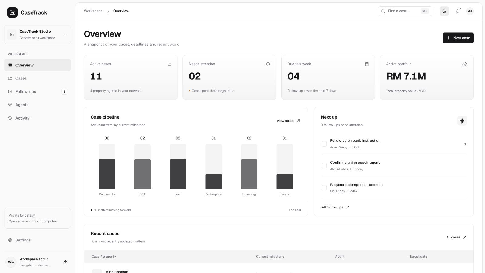

# CaseTrack

**A private, local-first workspace for conveyancing cases.**

CaseTrack is open-source case management for a single user on their own computer. Manage cases, property-agent contacts, milestones, follow-ups, internal notes and activity history in a shadcn/ui dashboard. Includes light and dark themes, search, a case board and CSV export.



## Install locally

Install [Node.js 24 LTS](https://nodejs.org/) or newer and Git. These commands work in macOS Terminal, Windows PowerShell and Linux shells:

```sh
git clone https://github.com/kuwe77/casetrack.git
cd casetrack
npm ci
npm run build
npm start
```

Open **http://localhost:4173**. On first launch, choose a workspace name. You can optionally load fictional sample cases. No passphrase or sign-in is required; later launches open your workspace directly. Rename it any time in Settings.

Later, run `npm start` from the same folder. Stop with Ctrl+C. No cloud account, external database, deployment, API key or environment file is required. Installation downloads dependencies; everyday operation works offline. Fonts are bundled, with no analytics or remote scripts.

> CaseTrack v0.1 is an early release. Review the [security model and limitations](SECURITY.md) before using it for confidential records. It is a local single-user application, not a shared office server.

## What you can do

- Open and update cases, assign a property agent and person in charge, and track deadlines and property value.
- Move cases through document collection, SPA, loan documentation, redemption, stamping, disbursement and completion.
- View cases in a searchable, filterable table or board.
- Create, complete and reopen follow-ups.
- Record internal notes and view the activity log.
- Manage property-agent contacts and firm details.
- Export cases to CSV and switch between light and dark mode.

“Agents” means property-agent contacts. There is no AI bot, chat assistant or automated agent.

## Data and security

The server listens only on `127.0.0.1`. Case records, contacts and activity are stored as an AES-256-GCM encrypted payload inside `data/casetrack.sqlite`. A random 256-bit key is generated automatically and saved in `data/workspace.key`. The SQLite file and journals contain encrypted record data.

There is no application login or lock. **Anyone who can access the running local server, or copy both the database and its key, can read and change the workspace.** Your OS account, file permissions and full-disk encryption are the access boundary. Local encryption protects a database copied without its key; it does not protect a stolen copy of the entire data folder.

Records are not stored in browser localStorage; only the light/dark preference is. CSV exports are **unencrypted**. Use FileVault, BitLocker or equivalent and lock your computer when leaving it.

### Back up and restore

1. Stop CaseTrack with Ctrl+C so SQLite can close cleanly.
2. Copy the **entire `data` folder**, including `workspace.key`, to a protected backup destination. Never commit it to Git or attach it to an issue.
3. Encrypt backups separately: the folder includes everything needed to decrypt your records.
4. To restore, stop CaseTrack, preserve your current data folder, copy the saved folder into the project, then run `npm start`.

Losing `workspace.key` makes the records unrecoverable. The app refuses to replace a missing or incorrect key when an existing workspace is present.

### Earlier passphrase-protected workspaces

Existing populated databases from the passphrase release are not automatically migrated. Keep an intact backup and use that release with the original passphrase to access them. This version stops with a clear error instead of overwriting the data. Fresh or uninitialized installations use automatic local keys.

By default, data lives beside the source. For a custom directory or port, set `CASETRACK_DATA_DIR` or `PORT` in your shell before `npm start`. The listening interface remains loopback-only. Use one server process per data directory. There is no supported LAN, reverse-proxy, Docker or public-hosting mode.

## Development

```sh
npm ci
npm run dev
```

Open **http://localhost:5173**. This starts Vite and the local API together; it uses the same data directory unless you set `CASETRACK_DATA_DIR`. For routine use, use the production build with `npm start` instead of the development server.

```sh
npm test
npm run build
npm audit
```

Tests cover business dates, overdue rules, CSV escaping, encrypted persistence, missing-key recovery, tamper detection, request-origin checks and local file permissions. CI is configured for Node 24 on Linux, macOS and Windows.

### Structure

- `src/` — React + TypeScript dashboard, shared models and fictional sample data
- `src/components/ui/` — shadcn/ui primitives, owned in the repository
- `server/` — loopback HTTP API, validation, encrypted SQLite store and security tests
- `scripts/dev.mjs` — cross-platform development launcher
- `data/` — runtime database and local key, excluded from Git

SQLite stores one encrypted workspace document, updated inside a transaction together with the activity event. This is deliberately scoped to a modest single-user workload; there is no multi-user conflict resolution. Case workflows currently use Malaysian conveyancing stages, MYR and Asia/Kuala_Lumpur business dates.

## Design and licensing

The interface uses [shadcn/ui](https://ui.shadcn.com/) components, Tailwind CSS and Geist. The [ShadcnStore dashboard](https://shadcnstore.com/templates/dashboard/shadcn-dashboard-landing-template/dashboard) informed the layout; no proprietary template source or artwork is included.

CaseTrack is [MIT licensed](LICENSE). See [CONTRIBUTING.md](CONTRIBUTING.md), [SECURITY.md](SECURITY.md) and [THIRD_PARTY_NOTICES.md](THIRD_PARTY_NOTICES.md).
